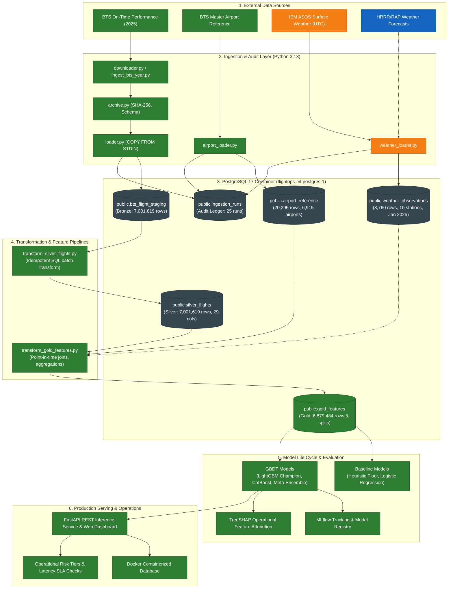

# FlightOps ML — System Architecture

> **Audit Status:** Verified against active repository and PostgreSQL container as of October 20, 2026.
> **Architecture Style:** Medallion Data Architecture (Bronze $\rightarrow$ Silver $\rightarrow$ Gold) + MLOps Life Cycle.

---

## 1. System Overview & Architectural Goals

FlightOps ML is engineered to demonstrate production-grade data engineering and machine learning practices for operational aviation risk.

### Architectural Principles

1. **Strict Idempotency:** Every ingestion and transformation pipeline can be executed repeatedly without generating duplicate records, orphaned rows, or inconsistent state.
2. **Auditability & Provenance:** Every row in Bronze and Silver retains its cryptographic SHA-256 source file fingerprint, source row number, and foreign-key link to an audited ingestion job.
3. **No Irreversible Imputation in Upstream Tiers:** Raw data anomalies (such as negative elapsed times or missing delay indicators) are preserved with high fidelity in Bronze and normalized cleanly in Silver.
4. **Point-in-Time Correctness & Leakage Prevention:** Upstream layers prohibit post-departure quantities. Future features must adhere to an operational cutoff 2 hours prior to scheduled departure.
5. **Separation of Operational Tiers:** Data is tiered logically and physically using the Medallion Architecture pattern:
   - **Bronze:** Untyped staging of raw files with ingestion audit trails.
   - **Silver:** Strongly-typed, normalized, validated domain entities.
   - **Gold:** Curated, time-sliced feature sets with explicit leakage prevention and dataset splits.

---

## 2. End-to-End Architectural Diagram

---

## 3. Technology Stack & Infrastructure

| Layer / Role | Technology | Version | Purpose & Rationale |
|---|---|---|---|
| **Language Runtime** | Python | 3.13 | Modern type hinting, native performance optimizations, standard library enhancements. |
| **Relational Database** | PostgreSQL | 17 (Docker) | High-throughput relational storage, streaming `COPY`, advanced check constraints, partial indexes. |
| **Container Engine** | Docker Compose | v2+ | Reproducible local PostgreSQL deployment with persistent volume mounting and healthchecks. |
| **Database Driver** | Psycopg 3 | 3.3.6 (binary) | Native binary protocol support, high-efficiency client-side `COPY` streaming, robust transaction semantics. |
| **HTTP Client** | Requests | 2.34.2 | BTS web scraping, session cookie handling, multi-part form emulation. |
| **Configuration** | Python-Dotenv | 1.2.4 | Twelve-Factor App configuration via `.env` files without hardcoding credentials. |
| **Testing** | Pytest | 9.1.1 | Unit testing, mock database execution, parameterized invariant checks. |
| **Linter & Formatter** | Ruff | 0.17.0 | Ultra-fast AST-based code linting (`E`, `F`, `I`, `UP`, `B`) and PEP 8 formatting. |
| **ML & Evaluation** | Scikit-learn, LightGBM, CatBoost, SHAP | 4.3+ / 1.2+ / 0.45+ | Gradient boosted trees, TreeSHAP explainers, Bayesian prior smoothing. |
| **Experiment Tracking** | MLflow | 2.22.x | Local SQLite experiment tracking, metrics, hyperparameter logging, model artifact registration. |
| **Inference Serving** | FastAPI, Uvicorn | 0.110+ | Real-time flight risk evaluation, sub-millisecond scoring, responsive interactive web UI. |

---

## 4. Architectural Tiers & Responsibilities

### 4.1 Ingestion & Staging Tier (Bronze)
- **Status:** **Verified Complete**
- **Artifacts:** `src/flightops_ml/ingestion/loader.py`, `scripts/ingest_bts_year.py`, `sql/001_create_staging.sql`.
- **Responsibilities:**
  - Authenticate and fetch monthly compressed archives from BTS.
  - Verify archive integrity: SHA-256 fingerprinting, single CSV member, required header verification.
  - Record the attempt in `public.ingestion_runs` with status `running`.
  - Stream all CSV columns as untyped `TEXT` into a temporary table via PostgreSQL `COPY FROM STDIN`.
  - Merge into `public.bts_flight_staging` using `ON CONFLICT (source_sha256, source_row_number) DO NOTHING`.
  - Update `public.ingestion_runs` to `succeeded` with exact counts (`records_seen`, `records_inserted`, `records_skipped`).
  - Roll back atomically on failure and mark the audit record as `failed` with the exception traceback.

### 4.2 Normalization Tier (Silver)
- **Status:** **Verified Complete**
- **Artifacts:** `src/flightops_ml/transformations/silver_flights.py`, `scripts/transform_silver_flights.py`, `sql/005_create_silver_flights.sql`, `docs/silver_flights.md`.
- **Responsibilities:**
  - Validate Bronze partitions before transformation (assert no invalid dates, carriers, or airport code anomalies).
  - Cast text columns into native SQL types (`DATE`, `TIME`, `TIMESTAMP`, `SMALLINT`, `BIGINT`, `DOUBLE PRECISION`, `BOOLEAN`).
  - Standardize 4-digit HHMM times (`crs_dep_time_str`, `crs_arr_time_str`).
  - Normalize edge-case clock times: convert `2400` to `TIME '00:00:00'` to satisfy Python and SQL standard time ranges.
  - Build scheduled timestamp (`crs_dep_timestamp`): roll `2400` flights to midnight of the following day while strictly preserving `flight_date`.
  - Enforce target integrity: ensure all cancelled flights have `dep_del15 = NULL` (never impute to 0).
  - Compute training eligibility flag (`is_training_eligible = TRUE` iff `dep_del15 IS NOT NULL AND cancelled = FALSE AND diverted = FALSE`).
  - Maintain idempotent load via `ON CONFLICT (source_sha256, source_row_number) DO NOTHING`.

### 4.3 Reference & Context Data Tier
- **Status:** **Verified Complete**
- **Artifacts:** `src/flightops_ml/ingestion/airport_loader.py`, `sql/004_create_airport_reference.sql`, `src/flightops_ml/ingestion/weather_bulk_ingester.py`, `src/flightops_ml/ingestion/weather_station_mapper.py`, `sql/002_create_weather.sql`.
- **Responsibilities:**
  - Provide dimensional attributes for flight legs (airport coordinates, local timezone offsets, station weather).
  - **Airport Reference:** 20,295 master airport records loaded. Solves historical airport changes across sequence IDs.
  - **Weather Staging:** Surface ASOS observations ingested across the Top 50 commercial US hubs for calendar year 2025. Demonstrates UTC parsing, quality auditing, and missing-value imputation.

### 4.4 Feature Store & Split Tier (Gold)
- **Status:** **Verified Complete**
- **Artifacts:** `src/flightops_ml/transformations/gold_features.py`, `scripts/transform_gold_features.py`, `sql/006_create_gold_features.sql`, `sql/007_create_top50_datasets.sql`.
- **Responsibilities:**
  - Join `silver_flights` with `airport_reference` using `origin_airport_id` / `dest_airport_id` with point-in-time validity checking (`flight_date BETWEEN airport_start_date AND COALESCE(airport_thru_date, '9999-12-31')`).
  - Apply strict 2-hour pre-departure feature cutoff ($T_{\text{obs}} \le T_{\text{dep}} - 2\text{h}$).
  - Compute historical delay aggregates (carrier delay rate, origin congestion) using strictly historical expanding-window priors (no same-day or future leakage).
  - Materialize explicit chronological partition labels: `train` (Jan–Aug 2025), `validation` (Sep–Oct 2025), and `test` (Nov–Dec 2025).

### 4.5 Modeling, Serving & Monitoring Tiers
- **Status:** **Verified Complete**
- **Artifacts:** `scripts/train_production_model.py`, `scripts/evaluate_test_holdout.py`, `src/flightops_ml/service/app.py`, `src/flightops_ml/explanation/explainer.py`.
- **Responsibilities:**
  - Model exploration on Train; hyperparameter tuning on Validation; one-shot benchmark on Test holdout ($N = 885,822$).
  - MLflow tracking of run parameters, ROC-AUC, PR-AUC, Brier score, and SHAP summary plots.
  - Production FastAPI inference service with TreeSHAP feature attributions and sub-15ms P95 latency.
  - Calibrated operational threshold $\tau^* = 0.21$ with risk tier categorization.

---

## 5. Network & Port Allocation

| Component | Host Port | Container Port | Protocol | Binding |
|---|---|---|---|---|
| PostgreSQL 17 | `5433` | `5432` | TCP | `127.0.0.1` (Local loopback only) |
| MLflow UI | `5000` | `5000` | HTTP | `127.0.0.1` |
| FastAPI Service (AeroPredict IO™) | `8000` | `8000` | HTTP | `127.0.0.1` / `0.0.0.0` |
